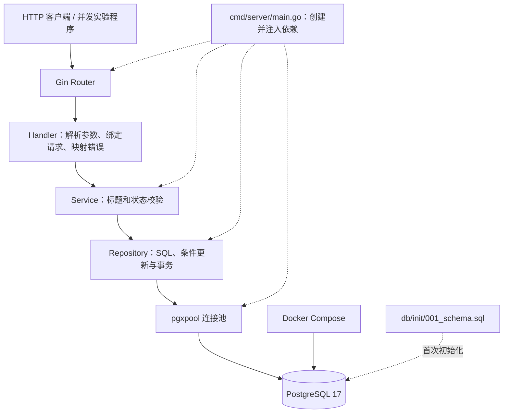
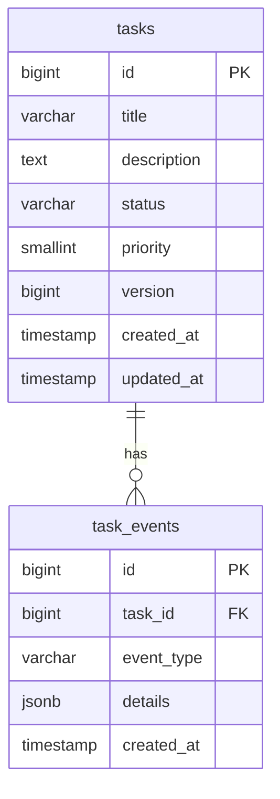
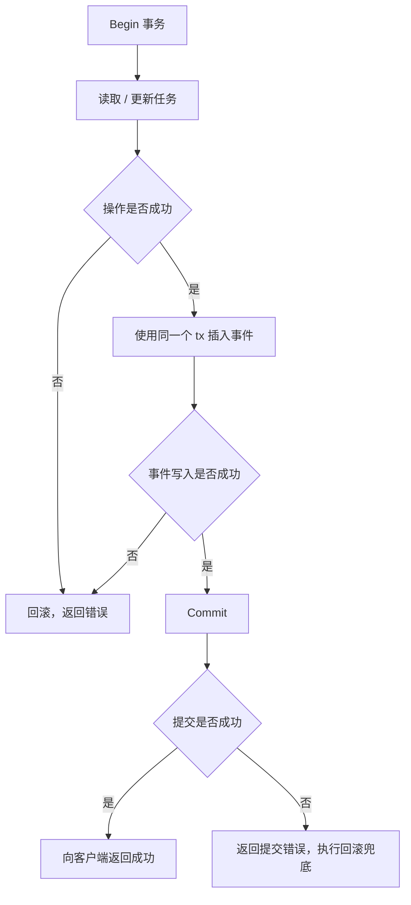
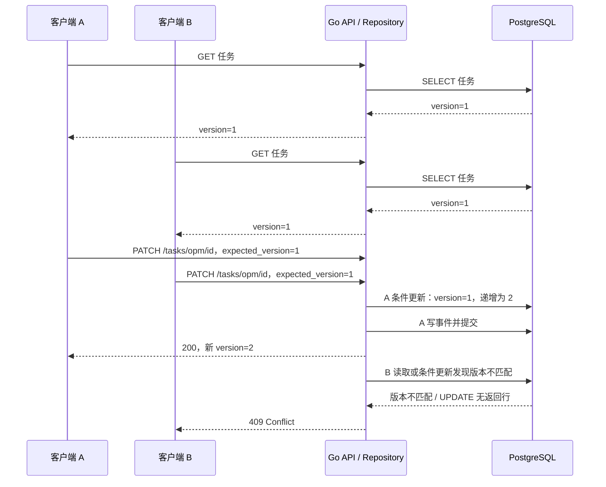
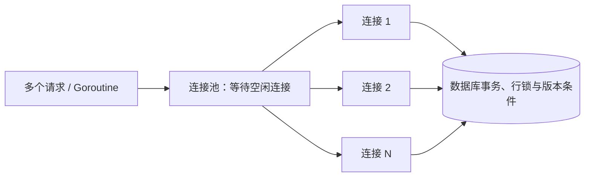

# CloudTask 架构与并发更新流程

以下图表使用 Mermaid，可在支持 Mermaid 的 Markdown 预览器或 GitHub 中查看。图表描述当前代码，不表示已部署高可用服务或实现完整测试。

## 1. 分层与依赖组装



| 目录 | 职责 |
| --- | --- |
| cmd/server | 创建连接池和各层实例，监听 8080 |
| internal/handler | 路由、请求转换、HTTP 状态和 JSON 响应 |
| internal/service | 业务输入校验；目前未限制状态转换方向 |
| internal/repository | 数据访问、版本检测和事件事务 |
| internal/database | 创建连接池并 Ping |
| internal/model | Task、TaskEvent 数据结构 |
| internal/requestbody | JSON 标签和绑定校验 |
| cmd/optimistic-demo | 向服务发送并发请求的独立客户端 |
| internal/config | 独立连接池实验，不是环境配置加载器 |

依赖通过构造函数从入口注入：Pool → Repository → Service → Handler。HTTP 请求的 context 传到 Service、Repository；入口的 5 秒 context 用于连接初始化，不是所有 HTTP 请求的统一 5 秒超时。

## 2. 数据关系



- tasks.id、task_events.id 使用 GENERATED ALWAYS AS IDENTITY。
- tasks.version 默认 1；priority 默认 3，数据库 CHECK 限定 1～5，但目前不暴露到 Task API 模型。
- 状态限定 pending、in_progress、completed；标题和事件类型不能全为空白。
- task_events.task_id 外键 ON DELETE CASCADE，任务删除会连带删除事件。
- 事件不是独立持久化消息队列，也没有对外 HTTP 查询接口。

索引：

| 索引 | 键 | 用途 |
| --- | --- | --- |
| tasks 主键 | id | 单任务查找和更新定位 |
| idx_task_status_created_at | status, created_at DESC | 状态筛选及时间排序实验 |
| idx_task_events_task_id_created_at | task_id, created_at DESC | 单任务事件查询与排序 |

HTTP 列表实际按 id DESC 排序，与任务联合索引的时间排序不同；是否采用某索引由优化器根据查询和统计信息决定。

## 3. 任务更新与事件的原子性



普通 PUT 写 task_updated；状态修改写 status_changed，包含 old_status、new_status。悲观锁入口在状态未变化时直接提交，不写事件。创建和删除没有额外事件记录。

提交时网络中断可能导致结果未知，不能仅因客户端收到错误就认定数据库一定没有提交；这种情况需要幂等策略或后续查询确认。

## 4. 乐观锁并发时序



图中以 A 获胜为例，实际获胜顺序不确定。若 B 的 UPDATE 等待 A 的行锁，默认 Read Committed 下会在 A 提交后重新检查条件，旧版本无法匹配。

真正的保护是原子条件：

```sql
WHERE id = $2 AND version = $3
```

先 SELECT 再用 Go 比较版本只是提前检测，不能替代条件 UPDATE。

## 5. 悲观锁与乐观锁的当前差异

| 项目 | PATCH /tasks/:id | PATCH /tasks/opm/:id |
| --- | --- | --- |
| 读取方式 | SELECT ... FOR UPDATE | 普通 SELECT |
| 客户端版本 | 绑定要求提交，但未比较 | 必须提交并比较 |
| UPDATE 版本条件 | 无 | 有 |
| 并发处理 | 等待锁后继续 | 检测旧版本并返回 409 |
| 新版本响应 | 不返回 | 在 data.version 中返回 |
| 相同状态 | 不增版本、不写事件 | 仍增版本并写事件 |

普通 PUT 虽递增版本，但无版本条件，且响应没有扫描到新版本。这些入口保留用于学习，不能对所有更新承诺“旧版本必定被拒绝”。

## 6. 连接池与 Go 并发的边界



并发任务数不等于连接数。普通使用下，一个连接同一时刻被一个借用者持有，事务从开始到结束通常一直占用连接。

连接池管理资源，不替代并发数据校验；Go Mutex 只作用于共享同一把锁的本进程代码，无法协调其他服务实例或直接 SQL 写入。

## 7. 后续完善方向

- 普通 PUT/PATCH 统一 expected_version 检查与成功响应。
- PUT 完整扫描并返回新版本。
- 将连接串和监听地址改为可配置，并补充迁移机制。
- 并发演示更新字段名并支持传入任务 ID。
- 增加真实的 API、事务回滚和并发冲突自动化测试。
- 按业务定义状态转换规则、鉴权和重复请求处理。
